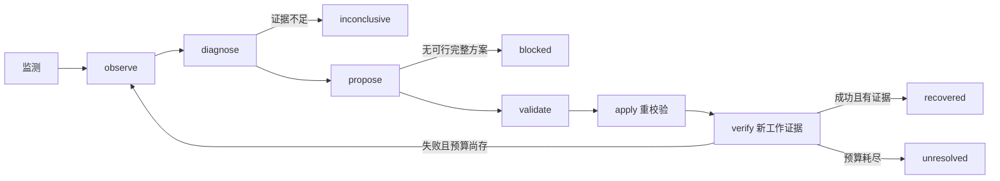

# FabricSandbox：通信规划、真实故障恢复与复杂性管理

> 2026-11-03 服务器执行版；更新自原 v2 架构报告。本文按 10 个分页单元组织，作为课程 8–12 页报告的可编辑源稿。新版 HTML 与图表在 `results/team_20261103_053106/`。同目录旧 `architecture_report.pdf` 尚未重新导出，不能代表本文的新实测结论。

## 第 1 页：封面与 Executive Summary

课程：MAiNS / 数据通信网络课程项目。Project Track：自选 Option 4，批准状态待团队确认。成员真实姓名、个人贡献确认及 GitHub/GitLab URL 待填；本地目录没有 `.git`，使用源文件 SHA256 标识版本，不虚构提交号。

FabricSandbox 面向共享 GPU 资源上的通信规划与故障处理。原系统包含静态放置代理和 DDP/TP 事件仿真；新增 CLI Agent 将观测、诊断、候选、校验、执行与新证据验证接成有界闭环。本次实际运行了回环 TCP 通道故障实验与单机 GPT-2 Small 两卡 DDP 故障恢复。各执行路径保留独立数据模型和能力边界。

结构复杂性通过 Controller/Adapter/Worker 与原领域内核的职责划分管理；行为复杂性通过版本、候选校验、完整组重建、原子检查点和有限重试管理；领域复杂性通过 GPT-2 参数/梯度/显存语义、固定 world size、真实设备 UUID 与不同证据类型管理。

结果：TCP 五场景及 B→A 恢复均符合预期；tiny GPU 冒烟及 GPT-2 四组对照通过；旧 A1 已导入两组 CPU 仿真；规划候选公平比较并保留拒绝理由。当前 47 个不同 Agent 测试均有通过证据、无跳过；CPU 独立审计 122 项与 GPU 审计 161 项通过。未配置真实 LLM API，未验证跨服务器/RDMA/物理交换机故障。

证据入口：`results/team_20261103_053106/index.html`；统一表 `experiment_table.md/json/csv`。本报告不把条件有限的功能验证解释成生产可靠性或统计性能提升。

<!-- PAGEBREAK -->

## 第 2 页：System Domain & Problem Statement

同步 DDP 每个 rank 保存完整模型与优化器状态；任一参与进程失效都会破坏固定通信组。仅换一个 GPU 标识、减小 world size 或打印重启成功都不能证明训练恢复。需要选出完整可行组合、加载最后完整提交的状态、再确认真实训练推进。

正式实测模型为 GPT-2 Small：12 层、768 hidden、12 heads、FFN 3072、词表 50257、位置 1024、绑定词嵌入/输出头，共 P=124439808 参数。FP32 梯度 4P=497759232 bytes；参数、梯度、Adam 两份状态基础存储约 16P=1991036928 bytes/卡，不能按 world size 平均。实际峰值还含激活、梯度桶与框架内存。

本轮使用随机初始化、合成 token、每 rank batch=1、sequence_length=128、FP32 AdamW。GPU 2、3 初始执行，4 备用；故障为已登记 rank 1 的 SIGTERM，不是 GPU 硬件破坏。第 5 步先提交 checkpoint，第 7 步门控注入，新组从第 5 步恢复到第 20 步。

TCP 用两条真实 localhost 转发通道将 64 KiB 校验块送达独立接收端，针对通道与接收服务分别探测。规划代理输入已知 node_down 故障，不做盲诊断。Qwen2.5-7B TP 仅存在原仿真语义：激活通信、KV 预算和副本故障；本次未运行真实 Qwen 推理。

| 证据类别 | 本次实例 | 可以支持的结论 |
|---|---|---|
| 实测 | TCP、tiny CUDA、GPT-2 DDP | 所记录配置下进程/传输/训练确实运行 |
| 仿真 | 导入 A1 后 compact/competition | 假设资源与时钟模型下的事件/约束 |
| 规划代理 | first_fit / rail_aware | 冻结输入下的逻辑放置、流和代价 |
| 测试替身 | FakeAdapter、ScriptPolicy | 工具门与错误处理，不是外部 LLM 实测 |

<!-- PAGEBREAK -->

## 第 3 页：High-Level Component Architecture

CLI Agent 由 `__main__` 驱动，Controller 不依赖 CUDA 或具体故障标签；Adapter 实现领域观测、约束、执行、验证；Worker 运行真实 TCP 或 DDP。独立注入线程只制造本实验进程故障，truth 不进入诊断接口。JSON/JSONL 支持离线报告与原始记录复核。

原规划路径由 `legacy_bridge → fabric_domain` 复用已有拓扑、放置、故障与评价模块；A1 导入由 bridge 验证测量合同，再调用 `fabric_sim`。这不是另写的替代系统，也没有把任意交换机图自动转换为 TCP 通道或 DDP 动态拓扑。

原 Web 路径仍为 `/workload → Gateway → SimulationService → fabric_sim`，SQLite 由服务保存输入与结果；只读 explain 使用事件引用。CLI Agent 没有接入 Web 角色认证。离线 HTML 是完成后证据视图，不能称实时 GPU 监控平台。NATS 旧骨架未进入这些主路径。

共享事件内核只处理容量、流与事件顺序；DDP/TP adapter 决定同步、checkpoint、请求和 KV 语义。这样修改模型状态无需各自重写资源容量规则；同时也明确了仿真与真执行不能直接共用耗时结论。

<!-- PAGEBREAK -->

## 第 4 页：Data Models、Contracts 与 Interfaces

| 合同 | 核心字段 | 关键约束 |
|---|---|---|
| Observation | status、evidence(id/kind/target/value)、facts | 来自实际探测/登记进程/进度；诊断引用当前 ID |
| Diagnosis | code、evidence_ids、affected、explanation | ID 非空且属于观测；不从注入器抄答案 |
| Candidate | id、version、action、target、cost、changes | 仅内部生成候选；不能任意 shell/改资源 |
| Receipt | version、idempotency_key、执行目标；DDP epoch/PID/checkpoint | 同键同方案复用回执；新旧 epoch 分开 |
| Verification | recovered、evidence、details | 成功且有新证据才可 recovered |
| Checkpoint manifest | file、sha256、step、epoch、world_size、committed_at | 文件完整写入及哈希后才发布 |
| SimulationSpec/Result | schema_version、input_hash、profile、events、checks | 数值单位与 provenance 分字段；服务终态不等于业务成功 |

六工具是 observe、diagnose、propose、validate、apply、verify；外部只有 validate/apply 传 candidate_id，其他必须空参数。内部 propose 调用 Adapter.candidates。TCP observe 会发工作负载块，不是零副作用查询；传输计数随监测次数变化。

原 HTTP 保留 POST `/api/v2/simulations` 返回 202/id/hash，GET 运行及 events，POST explain 只读；非法输入 422、队列忙 429、未知 id 404。输入约 2 MiB 上限；默认单执行线程和两等待名额。SQLite 保存不可变 spec 与结果，协调器重启把未完成项标 interrupted，不自动续跑。

TCP 协议按行 JSON、1 MiB 上限、固定回环地址；put 含 chunk_id/payload/SHA256，ping 不计工作量。receiver 的去重键保存在进程内存，统计落盘不等于可恢复去重日志。六工具详情与错误门见 `system_implementation_notes.md`。

<!-- PAGEBREAK -->

## 第 5 页：Behavioral State Machine & Control Flow

正常基线不运行故障 Agent。故障组开始监测后，实验线程才注入；Agent 根据观测状态进入控制闭环。默认最多 24 次工具调用、2 次执行尝试（构造参数最多允许 3）。原生 provider 错误可标 rules_fallback；后端执行错误进入 failed，不冒充 LLM 异常继续改资源。

TCP apply 先持久化新计划，再更新 active/version；失败块保持原 chunk ID，切换后先重试，再要求新块。实际两次恢复都经历 ACK 不完整，重试由 receiver 去重一次，unique 计数保持正确。

DDP apply 验证源文件哈希，冻结恢复 manifest，停止整个旧组，再启动新的两 rank 组。每个 rank 恢复模型、优化器及 CPU/CUDA/Python RNG；完成 step 6–20 后验证。GPU 2 可保留，但其旧 rank 进程不保留。无备用时只有一个健康槽，不能启动一 rank 组。

原仿真另用 execution_epoch 丢弃故障前迟到回调；checkpoint 保存完成事件才更新 durable step。TP 副本失效会使在途请求失败，不承诺 KV 无损迁移。真实进程重建、仿真事件取消、服务进程恢复是不同状态机制。

<!-- PAGEBREAK -->

## 第 6 页：Complexity Management Evaluation

| 维度 | 真实风险 | 管理机制 | 本次证据 |
|---|---|---|---|
| 结构 | 控制策略混入模型/网络执行；Web/CLI 混淆 | Controller/Adapter/Worker；三条明确路径 | 实现图、模块源码、GPU/TCP 独立 backend 标签 |
| 行为 | 半组训练、旧版本方案、重复启动、伪恢复 | 固定组、版本重校验、幂等回执、新证据、预算 | blocked 反例；版本/幂等测试；47 项覆盖 |
| 领域 | 把梯度/激活/KV 混用；把代理 Gbps 当实测 | 模型与 provenance 合同、每卡显存、固定 DDP 语义 | 124439808 参数、UUID、源 checkpoint、A1 独立标签 |
| 证据 | 打印成功而没有执行；真值泄漏；旧结果污染 | trace、执行/验证回执、独立 AST/原始文件审计、哈希与新目录 | CPU 122、GPU 161 项审计；命令与文件 manifest |

TCP 候选有 issued SHA256 防篡改；DDP Controller 仅接受自己发出的 ID，Adapter 校验版本/槽/检查点，但直接 Adapter API 不是独立的 issued-hash 安全边界。候选代价与可行性分开，不能为更少迁移绕过资源约束。

同键同方案幂等只在当前适配器内存中成立；重启后没有持久事务恢复。严格日志、fsync、整份检查点哈希和停止健康 rank 带来真实开销；这是可审计性与轻量课程实现的取舍，不是零损失在线迁移。

默认规划场景两个作业都受影响，健康集合为空。额外 node-0 故障场景保留非空健康作业 job-small-02，逐字段检查其放置未变，避免用 vacuous pass 证明保留能力。新增反例测试证明连续失败后仅 apply 两次，以及空新证据无法恢复。

<!-- PAGEBREAK -->

## 第 7 页：Implementation、运行与权限

原 GPU 环境为 Python 3.12.15、PyTorch 2.7.1+cu128、Transformers 4.52.4、CUDA 12.8、NCCL 2.26.2；未安装或升级依赖。FABRIC_PY 固定为相邻 FabricSandbox_v2 的 `var/owner_env/bin/python`。所有输出与临时文件在 GPFS 共享盘；checkpoint 保留服务器，轻量证据包排除 .pt。

| 入口 | 实际作用 |
|---|---|
| `-m agent_demo tcp-suite --mode rules` | 五组实际 TCP 反例矩阵 |
| `-m agent_demo tcp --initial-channel B --scenario recover` | 反向通道恢复 |
| `-m agent_demo planning` | 同一冻结输入的原规划器候选比较 |
| `scripts/run_agent_gpu_matrix.py` | tiny 后串行 GPT-2 四组，验收失败即停止 |
| `-m agent_demo reuse-profile` | 验证原 A1 并运行 CPU 仿真 |

完整绝对命令与时间/退出码在两轮 commands.jsonl，GPU 各子命令另存 command_*.json。原 Web 接口和共享 viewer/editor 权限为现有实现路径，本轮只作源码审查，未把 CLI 执行说成经过该认证。CLI 使用当前本地用户权限，没有个人账户、多租户隔离、审批服务或集群租约。

TCP 只清理本任务保存的 Popen 子进程；DDP 用 PID/PGID/进程启动身份校验登记 worker，launcher 使用自建进程组。没有广域 pkill、GPU reset 或全局网络设置。本轮未使用 GPU 0/1 上其它任务；进程是否在宿主可见受容器边界限制，不能把空 nvidia-smi PID 表解释为整机无任务。

LLM 配置仅检查是否存在，三项均无配置；LLM 外部工具调用未验证。测试中的 ScriptPolicy 不计作 LLM 成果。API 密钥、环境目录、数据库凭证不进入证据包。

<!-- PAGEBREAK -->

## 第 8 页：Verification & Experiments

| 实验 | 真实结果 | 验证范围 |
|---|---|---|
| TCP baseline / no-repair | healthy / unrecovered_control | 正常校验块与故障无恢复对照 |
| TCP recover A→B / B→A | 均 recovered；各 6 个唯一块、去重 1 次 | 三路探测、失败块重试、新块、计数一致 |
| TCP blocked / receiver-down | blocked / inconclusive | 不可行禁止执行；不误诊接收服务故障 |
| tiny CUDA 恢复 | 3152 参数，20 步完成 | 小模型真实进程/检查点冒烟 |
| GPT-2 baseline / no-repair | 20 步完成 / step 7 未恢复 | 正式模型健康与故障对照 |
| GPT-2 recover | 2、3 → 2、4；step 5 恢复到 20 | UUID、SHA256、新 PID、有限 loss、有效进度 |
| GPT-2 blocked | 两卡授权池故障后 blocked | world_size 保持 2，不缩卡 |
| A1 导入 | compact/competition 各两作业完成 | 实测计算输入 + 合成恢复/网络的 CPU 仿真 |

GPT-2 检测 70.765 ms，注入到两 rank 首个恢复步 12.555 s，训练完成 92.673 s，控制器终态 94.940 s，回滚 2 步。首个恢复步为重做 step 6，超过故障前进度为 step 8（13.188 s）。恢复源哈希一致，两个 rank step 6–20 loss 与健康基线对应值最大绝对差均 0.0；不据此承诺跨平台确定性。

测试证据为旧 45 项、受此前 checkpoint 修改影响的 14 项重跑、此次 2 项新增；14 与 45 重叠，当前不同测试总数为 47，不是 61。全部无失败/跳过，逐项清单与类型可追溯。真实运行审计与单元测试相互补充，不能相互替代。

<!-- PAGEBREAK -->

## 第 9 页：Analysis、Scaling & Trade-offs

默认规划的 node-1 故障使旧方案有 4 个失效 GPU 分配和 1 个不可路由 flow。first-fit 更换 4 个槽，rail-aware 更换 5 个；两者均可行，按最少更换选择 first-fit。二者 multi 作业吞吐代理同为 10 Gbps；first-fit 的 small 作业只有节点内通信，代理 null，不能将 rail-aware 的 10 Gbps 宣称为实际收益。补充健康保留场景两种策略更换数均为 4，按 ID 平局决策。

TCP 固定两候选；DDP 对 G 个允许槽枚举 O(G²) 两槽组合；checkpoint 哈希/加载为 O(S) 数据量。原 rail-aware 枚举有限顺序节点组与 compact/balanced 方式，是启发式而非全子集最优搜索。仿真事件堆每事件 O(log Q)，容量分配约 O(FP+R)；r rank 单次 Ring 约 O(r²) 流事件。默认 Web 为单执行线程，异步提交不等于多机并行计算。

本轮没有系统三档规模基准或重复统计，不给吞吐容量承诺。GPU 单次恢复耗时包含停止/启动、共享盘 checkpoint I/O、重做与后续训练；train_step_ms 排除门控、检查点和固定 pause。TCP 两方向各一次且 CPU 并行环境不同，不能以少量差值判断路径优劣。旧 A1 sequence=512，而 DDP=128；A2/A5 同机 NCCL 不代替跨服务器带宽。

取舍：严格组语义和哈希使恢复可验证，但放弃弹性缩卡、不中断健康 rank 和快速无损迁移；离线报告便于无 GPU 组员复核，但没有实时交互控制能力；全 checkpoint 保留增加服务器磁盘用量约 13.91 GiB，交接包不携带它们。

<!-- PAGEBREAK -->

## 第 10 页：结论、未实现内容与来源

本次把原静态规划/事件仿真与真实执行证据连通：相同 Controller 通过受约束工具管理 TCP 通道与 DDP 整组恢复，结果由实际传输或新训练步核验。反例说明资源不足与证据歧义是合法终态，不能通过减小通信组或读取注入答案制造成功。

未实现或未验证：跨服务器/RDMA/物理交换机故障、硬件根因、Qwen 实际 TP/KV 迁移、生产多租户租约、持久幂等与高可用、CLI Agent 的 Web 认证集成、真实 LLM API、规模压力实验。原仿真仍采用单桶 Ring、无计算通信重叠、静态 KV 预算；真实 DDP 使用 PyTorch 默认 DDP 同步机制，不能把仿真简化强加到实测执行路径上。

本轮生产模块无新增修复；此前唯一 GPU 修复是保留所有提交 checkpoint，防止源文件随后续提交被删除。新增两项测试及文档/图表 diff 保留。任务由工具接管执行，不代填两位组员的人工实验贡献或签字；团队仍需理解代码、核对真实姓名与分工、发布 Git 仓库、确认课程路线并现场演示。

交付为可编辑 Markdown、离线 HTML、PNG/SVG 和源 JSON。原报告 PDF 未更新，新的 PPTX/PDF 尚未导出；这不影响实验及源稿完整性。五分钟演示采用 TCP 现场运行 + 已完成 GPT-2 原始证据，避免临时占用 GPU。

本地可核验来源：

1. `docs/refactor/rubric_mapping.md`：课程评分与 8–12 页模板的现有整理；原课程 PDF 位于旧 Mac 路径，本服务器未取得，本文不声称本轮重新核对原 PDF。
2. `agent_demo/{__main__,controller,contracts,tcp_backend,tcp_worker,ddp_backend,ddp_worker,legacy_bridge}.py`：实际实现合同与执行代码。
3. `packages/fabric-domain/src/fabric_domain/`、`packages/fabric-sim/src/fabric_sim/`：规划代理和事件内核。
4. `services/gateway/src/gateway/{simulation_api,security}.py`：现有服务/权限边界，未与 CLI Agent 接通。
5. `results/server_20261103_050617/`：原始 GPU、A1 导入、A2/A5 复用和审计；原 source manifest + diff 标识实际版本。
6. `results/team_20261103_053106/`：本轮 TCP/规划、逐项测试覆盖、122 项审计、统一实验表和图表数据。

外部依赖为 Python、PyTorch、NCCL、Transformers；没有把其文档或模型卡的性能数值复制为本项目测量。正式引用链接可沿用原 README/AGENT_EXECUTION 中的官方资料；数值结论以本地原件为准。
